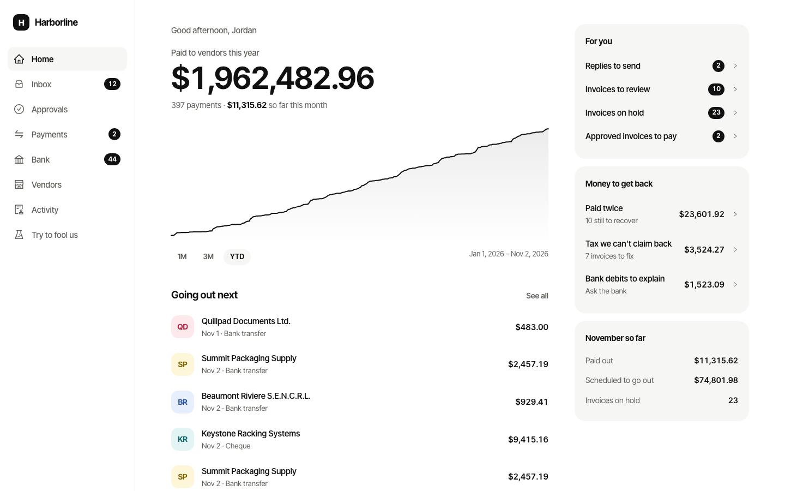
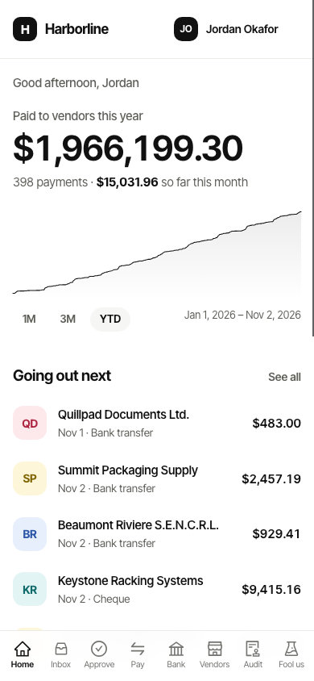
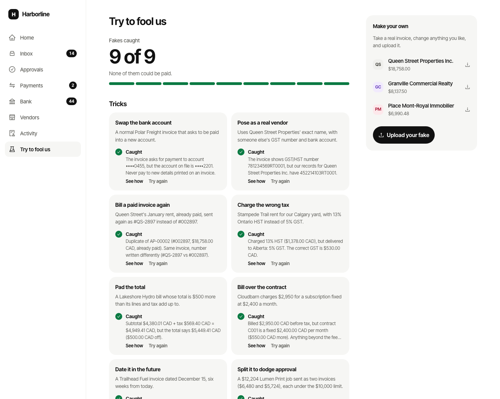
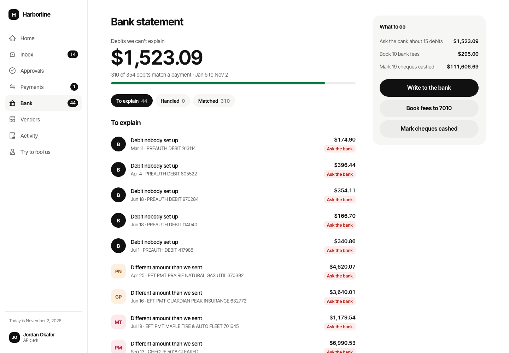
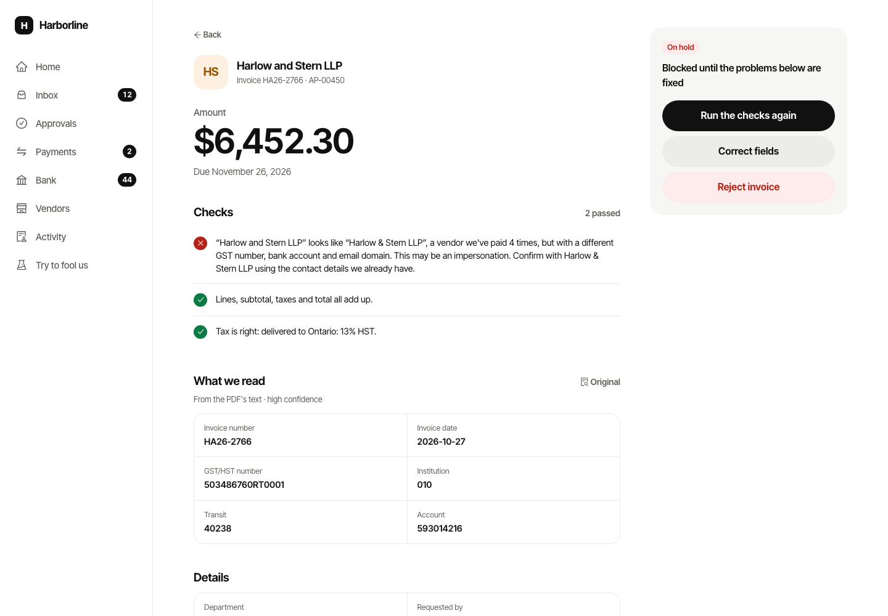
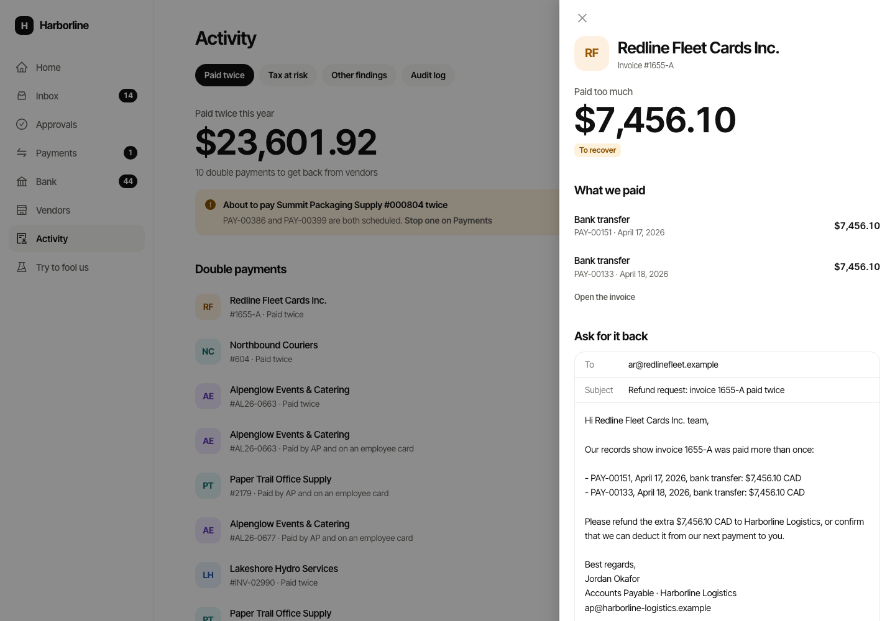
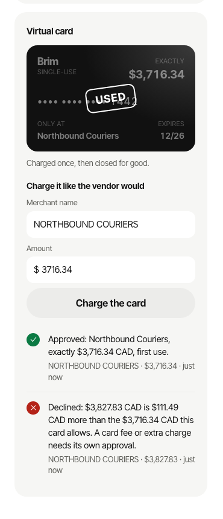
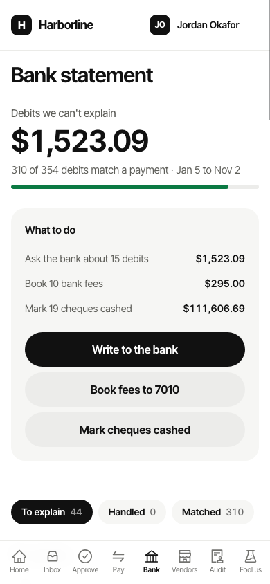
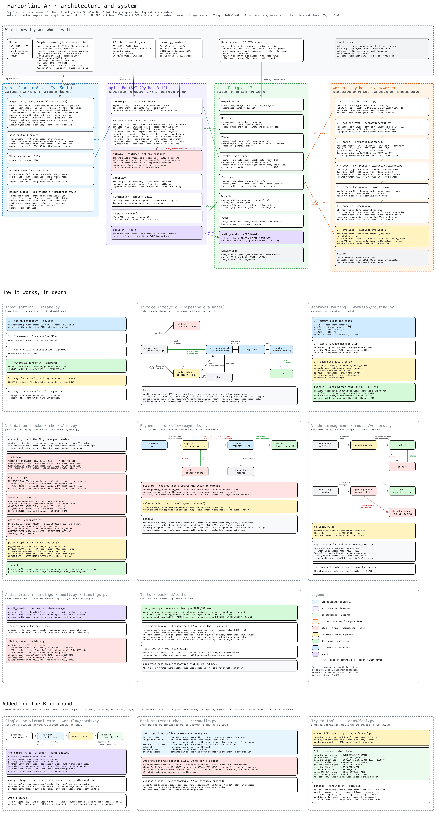
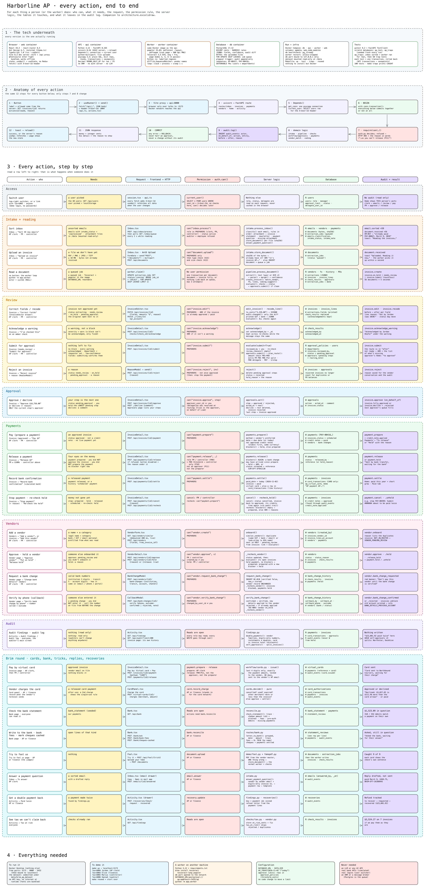

# Harborline AP

Accounts payable for Harborline Logistics, from the inbox to the payment: **intake → read → code → check → approve →
pay**, every step audited. CodeJam 16 · Brim Financial challenge. Payments are simulated.

<p>
  
  
</p>

| | |
|---|---|
| **50 / 50** | traps from the brief caught, each one an automated test (`make traps`) |
| **$23,601.92** | paid twice this year, found in the history, with a refund letter for each |
| **$1,523.09** | taken from the bank account that nothing explains, incl. a cheque that cleared 5¢ over what was written |
| **$3,524.27** | in sales tax we'd pay and could never claim back, on 7 invoices |
| **9 / 9** | forged invoices and bank changes caught on the *Try to fool us* page |
| **0** | AI models or external APIs: OCR + rules, the same answer every run, bank details never leave the machine |

## Run it

Needs Docker only.

```sh
make up        # db + api + worker + web; seeds the database on first start
```

Open **http://localhost:5173/?as=U004** (Jordan, AP clerk). Switch user with the picker at the bottom of the sidebar:
`?as=U003` Elise (finance manager), `?as=U002` Marcus (controller), `?as=U006` Hannah (auditor). API docs: http://localhost:8000/docs

| Command | What it does |
|---|---|
| `make up` | Start everything |
| `make reseed` | Back to the start (wipe and reload the dataset) |
| `make traps` | The TRAP_MAP checklist: one line per trap, CAUGHT or MISSED |
| `make test` | All 125 backend tests, on separate scratch databases |
| `make down` · `make psql` | Stop (data kept) · SQL prompt |

## The 9 required features

| # | Feature | How |
|---|---|---|
| 1 | **Intake** | Sorts the 59 emails by rules: invoices (one per attachment: EM-029 has two), statements and newsletters filed, a missing attachment gets a "please resend" reply drafted, a payment question gets an answer drafted from the payment record. Uploads too. |
| 2 | **Extraction** | PDF text layer when there is one; scans go through Tesseract three times and the readings are compared field by field. English and French. Confidence per field; anything doubtful goes to a person, who can correct it. |
| 3 | **Smart coding** | GL account and department learned from the 809 historical lines, with the reason in words: "All 10 past lines from this vendor went to 6620 Utilities". Editable. |
| 4 | **Validation + matching** | Vendor master, contracts, POs, tax by province, line and total arithmetic. Every finding is a sentence, never a code. |
| 5 | **Duplicates** | Reformatted numbers (`FA-000583` = `583`, `000903-A` = `000903`), duplicate vendor records, invoices already paid on a card. |
| 6 | **Approvals** | Rules P01–P08 read from the policy table, delegation recorded, no self-approval, one person per step, history on every invoice. |
| 7 | **Payments** | EFT, cheque or a **single-use virtual card**. Release limits P09–P11 (whoever approved or prepared can't release). Dashboard with every status. |
| 8 | **Audit trail** | One append-only table; the database itself refuses edits and deletes. Every payment links to its invoice, approvals, GL codes and people. |
| 9 | **Vendors** | Onboarding with a live duplicate check, holds, look-alike detection, bank changes held until someone calls the vendor back. |

## Beyond the brief

<p>
  
  
</p>
<p>
  
  
</p>

- **Try to fool us.** Nine one-click forgeries built from real vendor data (swapped bank account, impersonated
  vendor, re-sent paid invoice, wrong tax, padded total, over-contract, future date, split invoice, bank change by
  email). Each is a real PDF that goes through the same worker and checks as any invoice; the page shows what caught
  it. Judges can download a clean invoice, edit it, and upload their own.
- **Single-use virtual cards.** One card per payment, locked to the vendor, the exact amount and one charge. Every
  charge attempt is approved or declined with the reason on screen.
- **Bank statement check.** Every debit matched to a payment or explained: pre-authorized debits nobody set up, wire
  fees for wires we never sent, cents taken over what we sent, an altered cheque, cheques cashed but still "outstanding".
  The email to the bank is written for you.
- **Money to get back.** Double payments tracked to recovery, tax we can't claim back with the fix for each invoice.
- **Replies drafted, never sent.** Payment questions answered from our own records, for a person to send.

<p>
  
  
</p>

The bank check and the card's explained declines answer the most common complaints in Brim's own public reviews:
cards blocked with no reason given, fees nobody can explain, payments "not received".

## Architecture

<p>
  <a href="docs/architecture.png"></a>
  <a href="docs/action-flows.png"></a>
</p>

Click to open full size. Editable sources: [architecture.excalidraw](docs/architecture.excalidraw) (containers, data,
how each part works) and [action-flows.excalidraw](docs/action-flows.excalidraw) (every action: who, needs, request,
permission, server logic, tables, result). Open them at excalidraw.com → File → Open.

- **web**: React + TypeScript, Ant Design restyled. Displays only; no business rule lives in the browser.
- **api**: Python 3.12 + FastAPI, plain SQL (psycopg 3). Every permission is decided in one function, `can()`, and
  refused actions come back with the reason, shown under the disabled button.
- **worker**: reads documents off a queue in Postgres (`FOR UPDATE SKIP LOCKED`), so more workers can run, even on
  another machine: `docker compose up --scale worker=3`.
- **db**: Postgres 17. Money in integer cents. The audit table is append-only by trigger.

Business rules, and every judgment call with the alternative we rejected: [CLAUDE.md](CLAUDE.md).
The planted traps: [TRAP_MAP.md](TRAP_MAP.md).

## Demo in 5 minutes

1. **Inbox → Sort 59 new emails.** About 5 seconds later, every document is read: invoices land in *To review*,
   *On hold*, or go straight to approval when nothing is wrong.
2. **Open a held invoice** (Harlow **and** Stern): blocked as a look-alike of a vendor we've paid, in plain words.
3. **Approve, then pay**: switch to the approver named on the invoice → Approve; back to Jordan → Pay. Try to
   release as someone who approved it: refused, with the reason (P11). Release as the controller (U002).
4. **Pay by virtual card** (AP-00425, Northbound): pick *Virtual card* → Pay, release as Elise; charge it 3% too
   much (declined, reason shown), then the exact amount (paid), then again (declined: single use).
5. **Bank**: $1,523.09 nobody can explain → *Write to the bank*.
6. **Activity → Paid twice**: $23,601.92 to get back, a letter per vendor. **Tax at risk** next to it.
7. **Try to fool us**: hand it to someone and let them try.

`make reseed` puts everything back to the start.

## Layout

```
backend/app/schema.sql   every table, with comments on why it looks that way
backend/app/intake.py    sorts the inbox, drafts replies, queues documents
backend/app/worker.py    the extraction worker (queue, retries)
backend/app/extraction/  text layer / OCR, the bilingual parser, confidence
backend/app/coding.py    GL account + department suggestions with reasons
backend/app/checks/      one file per kind of check; run.py lists them all
backend/app/workflow/    approval routing (P01–P08), approvals, payments (P09–P11), single-use cards
backend/app/reconcile.py the bank statement check
backend/app/findings.py  double payments, recoveries, tax at risk, self-approvals, splits
backend/app/auth.py      can(): every permission decision
backend/app/demo/        "Try to fool us": the forgeries and a 40-line PDF writer
backend/app/routes/      one HTTP router per area
backend/tests/           pytest: the trap checklist, the workflow through the API, the bonus features
frontend/src/pages/      one file per screen
frontend/src/components/ shared building blocks (ui.tsx), the app shell, the card panel
frontend/src/styles.css  the design system
data/brim_ap_dataset/    the dataset (CSVs, inbox, incoming invoices)
```
